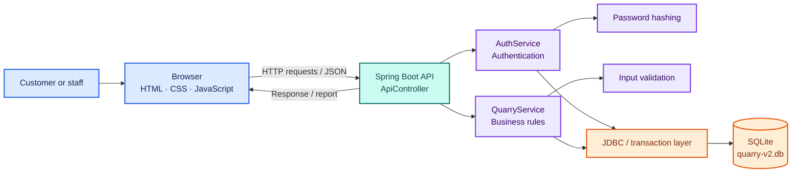
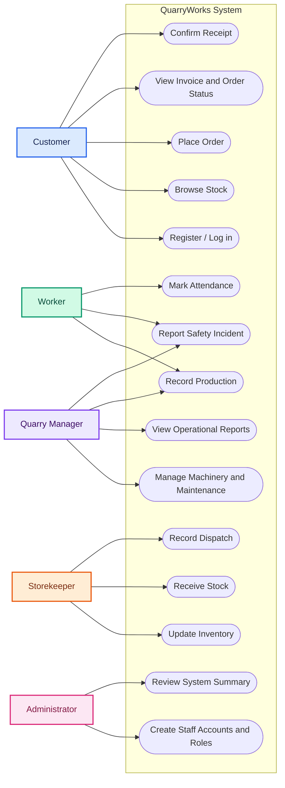
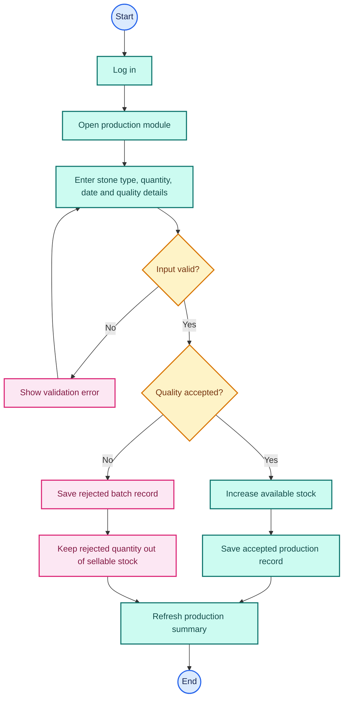
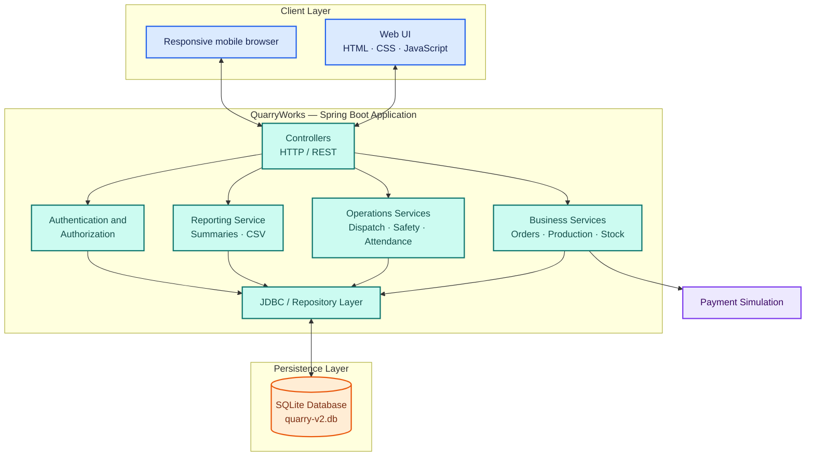
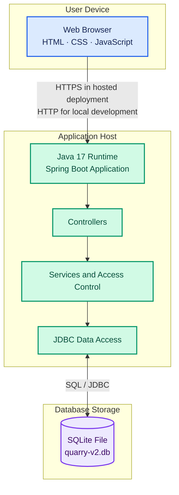
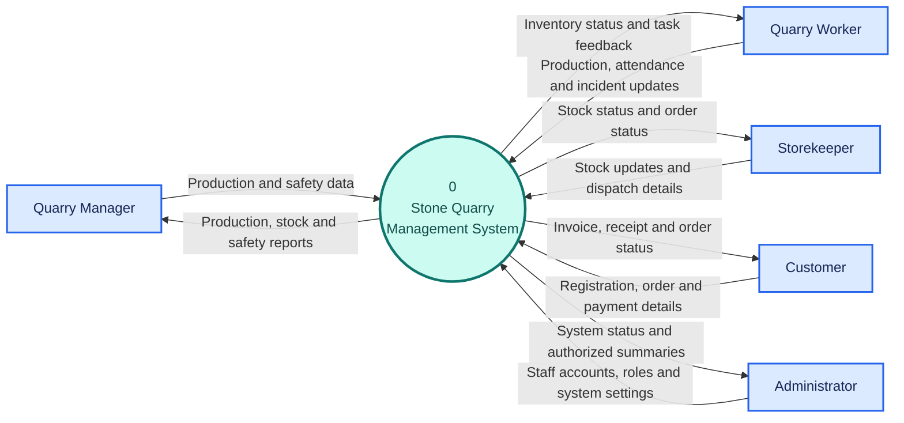
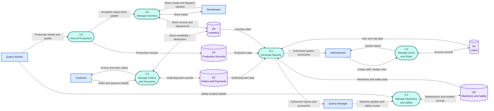

# QuarryWorks — Stone Quarry Management System

**A role-based web application for managing quarry
production, stone inventory, customer orders, payments, dispatch,
machinery, safety, and attendance.**
[](https://openjdk.org/)
[](https://spring.io/projects/spring-boot)
[](https://www.sqlite.org/)
[](https://maven.apache.org/)
> **Project note:** This README documents the intended design and
> workflows. Verify every feature, dependency, environment variable, and
> test against the source code before describing it as implemented.
> Payment is a simulation unless the code explicitly integrates a real
> payment provider.

## Contents

-   [Project overview](#project-overview)
-   [User roles](#user-roles)
-   [Technology stack](#technology-stack)
-   [Architecture](#architecture)
-   [Functional requirements](#functional-requirements)
-   [UML and data flow diagrams](#uml-and-data-flow-diagrams)
    -   [1. Use case diagram](#1-use-case-diagram)
    -   [2. Class diagram](#2-class-diagram)
    -   [3. Sequence diagram --- place an
        order](#3-sequence-diagram--place-an-order)
    -   [4. Activity diagram --- production
        recording](#4-activity-diagram--production-recording)
    -   [5. Component diagram](#5-component-diagram)
    -   [6. Deployment diagram](#6-deployment-diagram)
    -   [7. Level 0 DFD --- context
        diagram](#7-level-0-dfd--context-diagram)
    -   [8. Level 1 DFD](#8-level-1-dfd)
-   [Logical database overview](#logical-database-overview)
-   [Run locally](#run-locally)
-   [Testing](#testing)
-   [Security and data integrity](#security-and-data-integrity)
-   [Limitations](#limitations)
-   [Suggested repository structure](#suggested-repository-structure)
-   [Future improvements](#future-improvements)

## Project overview

QuarryWorks centralizes the key day-to-day activities of a stone quarry.
It is intended to reduce paper-based record keeping and make stock,
production, orders, and operational status easier to track.

### Main capabilities

-   Customer registration, stock browsing, order placement, invoice
    details, and order-status tracking.
-   Production records with stone type, quantity, date, and quality
    outcome.
-   Inventory receiving, stock adjustments, and low-stock monitoring.
-   Simulated payment records and order totals.
-   Dispatch details, vehicle/load information, and customer receipt
    confirmation.
-   Machinery status, scheduled maintenance, and maintenance costs.
-   Safety incident reporting and resolution tracking.
-   Worker attendance records.
-   Role-based access and authorized summaries/CSV reports.

## User roles

  -----------------------------------------------------------------------
  Role                                Main responsibilities
  ----------------------------------- -----------------------------------
  **Customer**                        Register, browse available stone
                                      stock, place orders, view
                                      invoices/status, and confirm
                                      receipt after dispatch.

  **Worker**                          Record production, report safety
                                      incidents, and mark attendance.

  **Manager**                         Monitor operations, review reports,
                                      manage machinery and maintenance,
                                      and coordinate dispatch.

  **Storekeeper**                     Receive/update stock, review
                                      eligible orders, and record
                                      dispatch details.

  **Administrator**                   Create staff accounts, assign
                                      roles, and review system summaries.
  -----------------------------------------------------------------------

Customers register themselves. Staff accounts are created by the
Administrator. **Permissions and ownership checks must be enforced on
the server**, not only by hiding menu items in the browser. Follow the
actual source code if its role rules differ from this design.

## Technology stack

  -----------------------------------------------------------------------
  Area                                Technology
  ----------------------------------- -----------------------------------
  Backend                             Java 17, Spring Boot

  Frontend                            HTML, CSS, JavaScript

  Database                            SQLite through JDBC, as described
                                      for the current project

  Build                               Maven

  Testing                             JUnit, if configured in `pom.xml`
                                      and the test source

  Hosting                             Render was discussed; verify the
                                      actual deployment configuration
  -----------------------------------------------------------------------

## Architecture



The browser sends requests to the Spring Boot application.
Authentication identifies the user, business services apply quarry
rules, and the JDBC/database layer reads or writes records. Use
transactions for workflows that must update an order and its stock
together. The exact classes and routes should be checked in the
repository.

## Functional requirements

These are intended requirements, not proof that every feature has passed
testing.

  -----------------------------------------------------------------------
  ID                                  Requirement
  ----------------------------------- -----------------------------------
  FR-01                               Allow customers to register and
                                      users to log in and log out.

  FR-02                               Allow a user to change their own
                                      password.

  FR-03                               Allow the Administrator to create
                                      staff accounts and assign roles.

  FR-04                               Enforce the project's one-Manager
                                      rule if it is part of the
                                      implemented specification.

  FR-05                               Check role permissions and record
                                      ownership on the server.

  FR-06                               Store stone details, quantity,
                                      price, and reorder level.

  FR-07                               Allow customers to view available
                                      stock.

  FR-08                               Allow authorized staff to receive
                                      stock.

  FR-09                               Record production and quality
                                      results. Accepted production
                                      increases available stock; rejected
                                      production must not increase
                                      sellable stock.

  FR-10                               Let customers place orders and
                                      check stock availability.

  FR-11                               Simulate payment and record the
                                      result.

  FR-12                               Create order/invoice details and
                                      deduct stock only for a
                                      successfully paid order, using a
                                      consistent transaction.

  FR-13                               Let authorized staff record
                                      dispatch and vehicle/load details.

  FR-14                               Allow only the owning customer to
                                      confirm receipt after dispatch.

  FR-15                               Record machinery status,
                                      maintenance details, and costs.

  FR-16                               Record safety incidents and
                                      authorized resolution updates.

  FR-17                               Record worker attendance.

  FR-18                               Provide authorized summaries and
                                      CSV reports.
  -----------------------------------------------------------------------

## UML and data flow diagrams

The diagrams below are embedded as Mermaid source. GitHub renders
supported Mermaid diagrams directly in a Markdown README. They are
conceptual design diagrams: update them when the source code or
permissions change.

### 1. Use Case Diagram



### 2. Class Diagram

This is a domain-level model. Match the class names, fields, methods,
and multiplicities to the actual Java implementation before treating it
as a source-code class diagram.

```mermaid
classDiagram
    direction LR

    class User {
      +Long id
      +String name
      +String email
      +String passwordHash
      +Role role
      +login()
      +changePassword()
    }
    class Customer {
      +String phone
      +placeOrder()
      +viewOrderStatus()
      +confirmReceipt()
    }
    class Worker {
      +String phone
      +recordProduction()
      +reportIncident()
      +markAttendance()
    }
    class Quarry {
      +Long quarryId
      +String quarryName
      +String location
    }
    class StoneStock {
      +Long stockId
      +String stoneType
      +double availableQuantity
      +double unitPrice
      +double reorderLevel
      +checkAvailability()
      +updateStock()
    }
    class ProductionRecord {
      +Long productionId
      +LocalDate date
      +double quantity
      +String qualityStatus
      +recordProduction()
    }
    class Order {
      +Long orderId
      +LocalDateTime orderDate
      +String status
      +double totalAmount
      +calculateTotal()
      +generateInvoice()
    }
    class OrderItem {
      +Long itemId
      +String stoneType
      +double quantity
      +double unitPrice
      +getTotalPrice()
    }
    class Payment {
      +Long paymentId
      +double amount
      +String status
      +String reference
      +processPayment()
    }
    class Dispatch {
      +Long dispatchId
      +String vehicleNumber
      +double loadWeight
      +LocalDateTime dispatchedAt
    }
    class Machinery {
      +Long machineId
      +String name
      +String status
      +updateStatus()
      +scheduleMaintenance()
    }
    class MaintenanceRecord {
      +Long maintenanceId
      +LocalDate maintenanceDate
      +double cost
      +String notes
    }
    class SafetyIncident {
      +Long incidentId
      +LocalDate incidentDate
      +String description
      +String status
      +updateStatus()
    }
    class Attendance {
      +Long attendanceId
      +LocalDate date
      +String status
      +markAttendance()
    }

    User <|-- Customer
    User <|-- Worker
    Quarry "1" --> "0..*" Worker : employs
    Quarry "1" --> "0..*" StoneStock : stores
    Quarry "1" --> "0..*" ProductionRecord : records
    Worker "1" --> "0..*" ProductionRecord : records
    StoneStock "1" --> "0..*" ProductionRecord : produces
    Customer "1" --> "0..*" Order : places
    Order "1" *-- "1..*" OrderItem : contains
    Order "1" --> "0..1" Payment : has
    Order "1" --> "0..1" Dispatch : dispatched as
    StoneStock "1" --> "0..*" OrderItem : fulfils
    Machinery "1" --> "0..*" MaintenanceRecord : has
    Worker "1" --> "0..*" SafetyIncident : reports
    Worker "1" --> "0..*" Attendance : records

    classDef user fill:#DBEAFE,stroke:#2563EB,color:#172554
    classDef operations fill:#D1FAE5,stroke:#059669,color:#064E3B
    classDef order fill:#EDE9FE,stroke:#7C3AED,color:#3B0764
    classDef safety fill:#FFEDD5,stroke:#EA580C,color:#7C2D12
    class User,Customer,Worker user
    class Quarry,StoneStock,ProductionRecord,Attendance operations
    class Order,OrderItem,Payment,Dispatch order
    class Machinery,MaintenanceRecord,SafetyIncident safety
```

### 3. Sequence Diagram --- Place an Order

The payment step represents the project's simulated payment workflow,
not a real payment gateway.

```mermaid
sequenceDiagram
    autonumber
    actor C as Customer
    participant UI as Web Browser
    participant API as Spring Boot API
    participant INV as Inventory Service
    participant PAY as Payment Service
    participant DB as SQLite Database

    C->>UI: Select stone and quantity
    UI->>API: Submit order details
    API->>API: Authenticate and validate request
    API->>INV: Check available stock
    INV->>DB: Read stock quantity and price
    DB-->>INV: Stock information
    INV-->>API: Availability result

    alt Stock available
        API->>API: Calculate total amount
        API->>PAY: Simulate payment
        alt Payment successful
            PAY-->>API: Payment success
            API->>DB: Save order and payment; deduct stock
            Note over API,DB: Commit related changes in one transaction
            DB-->>API: Saved order reference
            API-->>UI: Order confirmation and invoice
            UI-->>C: Display confirmation
        else Payment failed
            PAY-->>API: Payment failure
            API-->>UI: Failure message; do not finalize order
            UI-->>C: Show payment result
        end
    else Stock unavailable
        API-->>UI: Insufficient stock message
        UI-->>C: Show unavailable quantity
    end
```

### 4. Activity Diagram --- Production Recording

Accepted production is added to sellable stock. Rejected production is
retained as a rejected record and does not increase available stock.



### 5. Component Diagram



### 6. Deployment Diagram

This shows a typical deployment arrangement for the documented stack.
Adjust it to match the real hosting setup. A hosted SQLite file is not
automatically durable across restarts or redeployments.



### 7. Level 0 DFD --- Context Diagram

The Level 0 DFD treats QuarryWorks as one process and shows its external
actors and information exchanges. It intentionally does not show
internal database stores.



### 8. Level 1 DFD

This Level 1 DFD decomposes the system into major processes and data
stores. Data flows are conceptual and should be reconciled with the
implemented database schema.



## Logical database overview

The following are logical record groups, not a guaranteed listing of the
exact SQL schema.

  -----------------------------------------------------------------------
  Record group                        Example information
  ----------------------------------- -----------------------------------
  Users                               Name, login identifier, password
                                      hash, role

  Stone stock                         Stone type, available quantity,
                                      unit price, reorder level

  Orders and order items              Customer, items, quantities,
                                      prices, status, totals

  Payments                            Amount, simulated payment outcome,
                                      reference

  Production                          Worker, stone type, quantity, date,
                                      quality result

  Dispatch                            Order, vehicle, load/weight
                                      details, dispatch status and time

  Machinery and maintenance           Machine status, maintenance dates,
                                      notes, costs

  Safety incidents                    Reporter, incident details, status,
                                      resolution

  Attendance                          Worker, date, attendance status
  -----------------------------------------------------------------------

Consult the actual database implementation (for example, `Database.java`
if present) for table names, columns, indexes, and constraints.

## Run locally

### Prerequisites

-   Java 17, or the version configured in `pom.xml`.
-   Maven, or the Maven wrapper if the repository includes it.
-   The project's source code and configuration files.

### Build and test

Run these commands from the directory containing `pom.xml`:

``` bash
mvn clean test
mvn clean package
```

Run the executable JAR produced in `target/`. Replace the example
filename with the actual filename generated by Maven:

``` bash
java -jar target/<actual-jar-name>.jar
```

Open the configured local address, commonly `http://localhost:8080` when
the default Spring Boot port is used.

### Configuration and secrets

Check the application source and configuration files to confirm
supported environment variables and database paths. Do not assume that
variables mentioned in an older README are implemented.

-   Never commit real passwords, tokens, private keys, or secret `.env`
    files.
-   Use a non-production database for demonstrations and tests.
-   Changing a database path does not automatically migrate existing
    data.
-   Configure persistent storage or a managed database before hosting
    real records.

## Testing

Run configured automated tests with:

``` bash
mvn clean test
```

Suggested test cases include:

-   Invalid login and protected endpoints.
-   Role restrictions and customer order ownership.
-   Missing fields, invalid quantities, and invalid price inputs.
-   Insufficient stock and successful stock deductions.
-   Accepted versus rejected production.
-   Failed payment and prevention of unintended order finalization.
-   Dispatch and owner-only receipt confirmation.
-   Transaction rollback when an order or stock update fails.
-   Machinery maintenance and safety incident status changes.

These are recommended test areas, not a claim that tests already exist
or pass. Check the test source and Maven reports for evidence.

## Security and data integrity

-   Hash passwords with a suitable password-hashing mechanism; never
    store plain-text passwords.
-   Enforce role authorization and record ownership in server-side code.
-   Validate all user input on the server.
-   Use parameterized SQL statements to reduce SQL injection risk.
-   Use transactions for coupled order, payment-record, and inventory
    changes.
-   Avoid logging passwords, authentication tokens, or other secrets.
-   Restrict CSV reports to authorized users and avoid exporting
    unnecessary personal data.

## Limitations

-   Payment is a simulation unless a real provider integration exists in
    the code.
-   Manual weight entry is not automatic weighbridge integration.
-   Machinery records do not control physical quarry equipment.
-   Receipt confirmation is a system record, not independent proof of
    physical delivery.
-   SQLite can be suitable for a small local demonstration, but a hosted
    application needs deliberately configured durable storage. A free
    hosting filesystem may be ephemeral.
-   The diagrams describe the intended design and must be verified
    against the actual application.
-   No live deployment, performance benchmark, or passing test result is
    claimed by this README.

## Suggested repository structure

Adapt this example to the files actually present in your repository:

``` text
QuarryWorks/
├── README.md
├── pom.xml
├── src/
│   ├── main/
│   │   ├── java/
│   │   └── resources/
│   └── test/
└── docs/
    └── images/
```

The Mermaid diagrams are already embedded in this README, so separate
image files are not required for GitHub rendering. If you also add
exported diagram images, store them in `docs/images/` and link them with
relative paths such as
``.

## Future improvements

Potential future work:

-   Replace local SQLite with a managed persistent database for hosted
    deployments.
-   Integrate a real payment provider with appropriate security
    controls.
-   Add notifications for low stock, overdue maintenance, and order
    status changes.
-   Add delivery evidence and weighbridge integration.
-   Add audit logs for sensitive administrative and stock operations.
-   Add role-specific dashboards and exportable reports.

## License

No license is specified here. Add a `LICENSE` file if you intend to
publish or allow reuse of the project.
